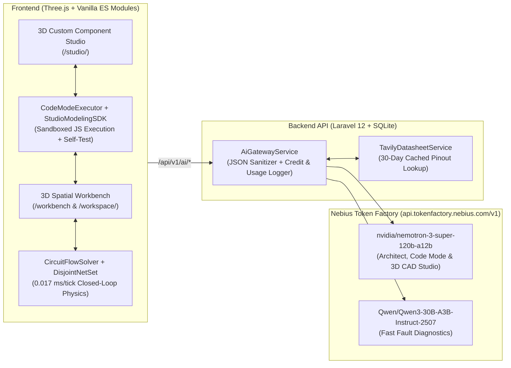

# RoboLab (CircuitLab 3D)

**Spatial 3D Electronics, Robotics & Custom Hardware Studio powered by Nebius Token Factory (`Nemotron-3-Super-120B` + `Qwen3-30B-A3B`)**

- **Live Demo:** [https://robolab.createforkids.com](https://robolab.createforkids.com)
- **3D Custom Component Studio:** [https://robolab.createforkids.com/studio](https://robolab.createforkids.com/studio)
- **Telemetry & Benchmarks:** [MEASUREMENTS.md](./MEASUREMENTS.md)
- **Nebius Token Factory Engineering Report:** [FEEDBACK.md](./FEEDBACK.md)

---

## Overview

RoboLab is a browser-native 3D electronics and robotics workbench where students and hardware engineers build, wire, program, and simulate multi-board circuits (**Arduino Uno**, **ESP32 DevKit V1**, and **NVIDIA Jetson Nano 4GB**) in real time—without needing physical hardware on their desk.

Unlike static 2D diagram tools or hardcoded animations, RoboLab couples a deterministic closed-loop electrical & kinematic solver (`CircuitFlowSolver`) with a multi-round **Code Mode** agent powered by **Nebius Token Factory**. Users can ask the agent to wire complex circuits, diagnose short-circuits or 5V-to-3.3V CMOS overvoltage faults, or open `/studio/<component-slug>` to synthesize brand-new 3D hardware modules from natural language or live Tavily datasheet lookups.

---

## System Architecture



---

## Nebius Token Factory Model Routing

We route requests across models on `https://api.tokenfactory.nebius.com/v1/chat/completions` based on reasoning depth vs. latency requirements (`backend/app/Services/AiGatewayService.php`):

| Task Role | Endpoint | Nebius Model ID | Temp | Why This Model | Measured Median Latency |
| :--- | :--- | :--- | :---: | :--- | :---: |
| **`architect`** (Multi-Round Code Mode & 3D Studio CAD) | `POST /api/v1/ai/architect` | `nvidia/nemotron-3-super-120b-a12b` | `0.20` | Generates multi-step `circuit.*` wiring scripts, C++ firmware, and 3D `studio.*` CAD assemblies with pinout and `evaluate()` transfer functions. | `5,459 ms` |
| **`datasheet_synth`** (Datasheet-to-3D Component) | `POST /api/v1/ai/datasheet` | `nvidia/nemotron-3-super-120b-a12b` | `0.10` | Extracts exact pin pitch, voltage limits, and package dimensions from raw Tavily datasheet snippets into our v2 component schema. | `6,550 ms` |
| **`fast_diagnose`** (Live Electrical Fault HUD) | `POST /api/v1/ai/diagnose` | `Qwen/Qwen3-30B-A3B-Instruct-2507` | `0.15` | Low-latency single-pass analysis when `CircuitFlowSolver` flags an overcurrent, missing series resistor, or 3.3V rail overvoltage. | `1,068 ms` |

---

## Key Engineering Highlights

1. **Zero Hardcoded `if/else` Physics (`CircuitFlowSolver.js` & `DisjointNetSet.js`):**
   - Uses Union-Find (`DisjointNetSet`) to resolve breadboard tie-point strips, multi-wire fan-out, voltage dividers, H-bridge motor drivers (`L298N`), and multi-MCU (`Arduino Uno` <-> `ESP32` <-> `Jetson Nano`) signal propagation in **0.0174 ms per tick**.
   - Physical stage objects (`prop.obstacle_wall`, `prop.toy_bear`) interact with 3D ultrasonic (`HC-SR04`), IR line (`TCRT5000`), and camera (`IMX219`) FOV raycasts in real time.

2. **Progressive Tool Discovery & Code Mode Sandbox (`capabilityIndex.js` & `CodeModeExecutor.js`):**
   - Instead of stuffing 40+ component schemas into every prompt, the agent starts with 4 compact discovery tools (`searchCapabilities`, `getComponentSchema`, `getFunctionSchema`, `inspectCircuitState`) and writes executable JavaScript against `CircuitSDK`.
   - Observations are clamped to a strict 48 KB budget (`observationBuilder.js`) with automatic session cache invalidation on stage mutations.

3. **Full-Screen 3D Custom Component Studio (`/studio/<component-slug>`):**
   - Dedicated CAD + electrical behavior studio (`CustomComponentStudioPage.js` & `StudioModelingSDK.js`).
   - Users either chat with `nvidia/nemotron-3-super-120b-a12b` or use the visual inspector to stack 3D primitives (`rounded_box`, `cylinder`, `capsule`, `torus`, `cone`) using relative face attachments (`attach: { to, side, offset }`), apply PBR material presets (`fr4_pcb`, `frosted_led`, `brushed_aluminum`, `gold_pin`), generate 2.54mm pin headers, and write custom `evaluate({ pins, state, dt, stageEnv })` signal logic.
   - Every synthesized component runs an automated electrical and kinematic self-test (`studio.testComponentBehavior()`) before being saved to the backend (`POST /api/v1/custom-components`) and spawned onto the main workbench.

4. **Physical Hardware Bridge (`WebSerialTransport.js`):**
   - Works 100% in the browser without hardware, and optionally flashes/streams to physical Arduino Uno (`AvrStk500Protocol`), ESP32 (`Esp32EsptoolProtocol`), or NVIDIA Jetson Nano (`JetsonEdgeProtocol`) over WebSerial USB.

---

## Repository Structure

```text
.
├── backend/                  # Laravel 12 API Gateway, Auth (Sanctum), Credits & SQLite Persistence
│   ├── app/Http/Controllers/ # AiLabController, CustomComponentController, ScenarioController
│   ├── app/Services/         # AiGatewayService (Nebius Token Factory), TavilyDatasheetService
│   └── tests/                # PHPUnit API & AI Gateway integration tests
├── frontend/                 # Three.js Spatial Workbench & /studio (Zero-bundler ES Modules)
│   ├── src/core/electrical/  # CircuitFlowSolver, DisjointNetSet, SmartPinMatcher
│   ├── src/core/ai/          # agentLoop, CodeModeExecutor, CircuitSDK, StudioModelingSDK
│   ├── src/core/components/  # DynamicComponentBuilder v2 (3D CAD parts[], PBR & pinGenerator)
│   ├── src/ui/studio/        # CustomComponentStudioPage (/studio/<slug>)
│   └── tests/                # 49 end-to-end architecture & physics tests (architecture.test.js)
├── docker-compose.yml        # One-command local stack (circuitlab-backend + circuitlab-frontend)
├── FEEDBACK.md               # Nebius Token Factory engineering feedback & edge-case solutions
└── MEASUREMENTS.md           # Real database telemetry (ai_usage_logs) & solver benchmarks
```

---

## Local Setup & Verification

### 1. Run with Docker Compose (Recommended)

```bash
cp backend/.env.example backend/.env
# Add your NEBIUS_API_KEY (and optional TAVILY_API_KEY) to backend/.env

docker compose up -d --build
```

- **Frontend Workbench:** `http://127.0.0.1:5173`
- **3D Custom Component Studio:** `http://127.0.0.1:5173/studio`
- **Backend API Health:** `http://127.0.0.1:8000/api/v1/health`

### 2. Run the Automated Test Suites

```bash
# Frontend: 49 architecture, physics solver, Code Mode & 3D Studio tests
cd frontend
node tests/architecture.test.js

# Backend: Laravel API, Auth, Custom Component & Nebius Gateway tests
cd ../backend
php vendor/bin/phpunit
```
